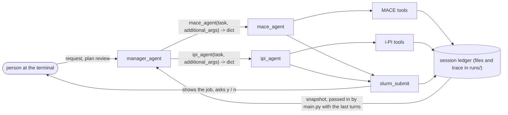

# smolagents_project

A scientific agent for people who train MACE machine-learning potentials and run i-PI molecular dynamics on a
Slurm cluster. A person describes a job in plain language at a terminal. A manager agent hands the request to a
MACE agent or an i-PI agent. The sub-agents are prompted to ask for what is missing and write the job files
through typed tools. The submit tool itself shows the job to the person and runs `sbatch` only after the person
types `y` (or `yes`). It is built on Hugging Face [smolagents](https://github.com/huggingface/smolagents) 1.26.0, with agents
that act by writing Python code.

Status. No live language model has been run against this version: every agent-level test drives the real agents
with a scripted model. Nothing has run on a real Slurm cluster: `sbatch`, `squeue`, `sacct` and `sinfo` are fakes
in the tests. Generated job scripts are syntax-checked with `bash -n` by three tests and were read; no job script
was executed.

## Architecture



| Part | What it is | Where |
|---|---|---|
| `manager_agent` | CodeAgent with no tools; delegates; the person reviews its plan | `agents.py` `build_agents` |
| `mace_agent` | CodeAgent: MACE option look-up, job script, pre-flight, submit, job status | `agents.py`, `tools/mace_*.py` |
| `ipi_agent` | CodeAgent: i-PI templates, tag help, input, ASE client, job script, submit | `agents.py`, `tools/ipi_*.py` |
| Shared tools | `slurm_config`, `preflight`, `slurm_submit`, `job_status`, `show_content`, `user_input`, `web_search` | `tools/` |
| Session ledger | Files the tools wrote (path, sha256, bundle), jobs submitted, the cluster probe | `tools/session.py` |
| Trace | One JSON line per event of a session | `tools/trace.py` |
| REPL | One request = one run of the manager | `main.py` |

## Who decides what

| The agents decide | The tools enforce in code | The person decides |
|---|---|---|
| Which sub-agent gets a request, in what order | Only a job script written by this session's generator tools, unchanged since (sha256), is submitted, and only once (`tools/slurm_submit.py`, `tools/session.py`) | Approve, modify or cancel each plan of the manager |
| What to ask the person, and when | Pre-flight before every submission: `#SBATCH` header, partition and time limit against the cluster probe, every file of the bundle unchanged (`tools/preflight.py`) | Each submission: `y`, `n`, or what to change |
| Which template, options and values to try | The question to the person is asked by the submit tool at call time; without a terminal, or at end of input, it declines (`tools/approval.py`) | Answers to the agents' questions (paths, partition, model) |
| Which tools to call, and when to stop | Generated code may import `json` besides smolagents' base modules (`math`, `re`, ...); `os`, `subprocess`, `sys`, `open` are blocked (`agents.py`) | Whether a failed job is resubmitted |
| What to report back | A sub-agent's status comes from the run state or the exception; its files and jobs from the ledger (`agents.py` `ScienceAgent`) | |
| | Cancel at plan review stops the turn before any action (`tools/customize_plan.py`) | |
| | Every input problem in one error; names and paths in a restricted alphabet (`tools/specs.py`) | |
| | MACE options checked against the option table of the job's MACE when it is visible, else a local MACE or release 0.3.17; the script records which (`tools/mace_cli_schema.py`, `tools/mace_script.py`) | |
| | i-PI input loaded by i-PI itself; only listed paths editable; values without units reported (`tools/ipi_check.py`, `tools/ipi_InputFile_generator.py`) | |
| | Socket, structure file and client count agree across input, client and job script (`tools/ipi_runase_generator.py`, `tools/ipi_submit_generator.py`) | |
| | Generated files are never overwritten and have LF line endings (`tools/session.py`) | |
| | `sbatch` without an answer in 60 s gives status `unknown`, never an invented job id (`tools/slurm_submit.py`) | |

## What changed since v1

v1 is commit `3fc8270`. It was measured with a scripted model driving the real v1 code, with `sbatch` replaced by
a recorder; the tool cases were run by calling the v1 tools directly. Each row gives the v1 code that causes the
behaviour, so it can be checked by reading. [docs/V1_DEFECTS.md](docs/V1_DEFECTS.md) has every defect, including
the open ones.

| v1 behaviour (measured) | v1 code at 3fc8270 | Now | Test |
|---|---|---|---|
| Person answers after 35 s: time-out errors after the sub-agent succeeded | `main.py:71-115`, no `executor_kwargs` (default 30 s) | No executor time-out; time-outs inside blocking tools | `test_agents.py::test_a_no_agent_has_an_executor_time_out` (configuration only) |
| Cancel at plan review: a sub-agent still ran and submitted | `tools/customize_plan.py:75` `agent.interrupt()` | Only the planning call runs; session goes on | `test_agents.py::test_b_cancel_at_plan_review_runs_nothing_and_the_session_goes_on` |
| Ctrl+C at `User>`, in `user_input` or in a model call ends the CLI | `main.py:121`, `main.py:130` | Ends the turn; at the prompt ends cleanly | `test_agents.py::test_c1_ctrl_c_at_the_prompt_ends_the_session_cleanly`, `test_c_ctrl_c_inside_a_turn_leaves_a_usable_session`, `test_c3_ctrl_c_during_a_model_call_ends_only_that_turn` |
| Generated code ran shell commands in all three agents | `main.py:77-82, 92-97, 109-113` | `import os`, `open`, `eval` ... blocked | `test_gate_probes.py::test_no_shell_no_files_no_modules_in_any_agent` |
| A sub-agent submitted without any question | `tools/slurm_submit.py:13` | The tool asks; `n` means no `sbatch` | `test_agents.py::test_e_submit_without_review_asks_the_person_and_a_no_stops_it` |
| `slurm_submit` accepted any file | `tools/slurm_submit.py:13` | Refused: 4 spellings of a hand-written file | `test_gate_probes.py::test_no_tool_runs_sbatch_on_a_file_it_did_not_generate` |
| Sub-agent 503 or step limit: "Task completed successfully!" | `main.py:127-129` | Dict with `status` `error` / `incomplete` | `test_agents.py::test_f2_provider_error_in_a_sub_agent_reaches_the_manager_as_status_error`, `test_f3_sub_agent_out_of_steps_is_incomplete` |
| Manager provider error: printed, loop went on (no defect) | `main.py:130-134` | Kept: turn `failed: <error>`, next turn answered | `test_agents.py::test_f4_provider_error_at_planning_fails_the_turn_and_the_session_goes_on` |
| Slurm tools on a machine without Slurm: raw `[WinError 2]` | `tools/get_server_info.py:73` | `available: False` with a reason; `failed`; `UNKNOWN` | `test_server_info.py::test_slurm_config_without_slurm`, `test_slurm_submit.py::test_sbatch_missing_is_failed`, `test_slurm_status.py::test_without_slurm` |
| MACE cases: junk in `#SBATCH`, `r_max "5.0"` refused, `~` never expanded | `tools/specs.py:154-157`, `tools/mace_cli_schema.py:194-197`, `tools/mace_script.py:25-26` | Junk refused, `"5.0"` accepted, `"$HOME/..."` | `test_mace_script.py::test_rejected_cases_write_nothing`, `test_accepted_cases` |
| Two files in one second: second overwrote the first | `tools/mace_script.py:220-221` | One bundle per job; never overwritten | `test_session.py::test_write_artifact_refuses_overwrite` |
| i-PI: socket pointed at another host, `total_steps "-5 abc"`, two `<prng>` accepted | `tools/ipi_InputFile_generator.py:95-136` | Refused or reported by i-PI's loader | `test_ipi_generators.py::test_baseline_input_cases` |
| A temperature without units is read in atomic units | no check | Reported: "300" is 9.47e7 K | `test_ipi_check.py::test_the_unit_trap_is_reported_with_the_value_ipi_understood` |
| i-PI job always requested a GPU | `tools/ipi_submit_generator.py:23-24` | GPU only for a `cuda` client | `test_ipi_generators.py::test_gpu_request_follows_the_client_device` |
| `github_fetch`: HTML for blob URLs, no time-out, any URL | `tools/github_fetch.py:15` | Raw URL, GitHub only, 30 s, 1 MB | `test_fetch_retriever_main.py::test_github_fetch_uses_timeout_and_raw_url` |
| Retriever: chunks up to 600 tokens (model reads 512), no sources | `tools/RetrieverTool.py:36-43, 83-89` | At most 512 tokens; a source line per passage | `test_retriever.py::test_each_passage_is_followed_by_its_source` (the 512 check is a test that is skipped without the retrieval packages) |
| About 52 s to the first prompt (index built at import) | `main.py:6`, `tools/RetrieverTool.py:13-62` | 1.72 s median of 5, index built on first query | `test_agents.py::test_building_the_agents_needs_no_retrieval_packages` (imports only, not the time) |

Test files are under `tests/`. Both start-up times come from one Windows machine: v1 about 52 s (with network
access); now the median of 5 runs with placeholder settings and no model call.

## Quick start

Python 3.11 is the only version used so far.

```bash
python -m venv .venv
.venv/bin/pip install -r requirements.txt        # Windows: .venv\Scripts\pip
cp .env.example .env                             # then set SMOLAGENTS_MODEL_ID and SMOLAGENTS_API_KEY
.venv/bin/python main.py                         # run from the repository root
```

Settings (`config.py`, environment first, then `.env`): `SMOLAGENTS_MODEL_ID` and `SMOLAGENTS_API_KEY` are
required; `SMOLAGENTS_API_BASE` (any OpenAI-compatible endpoint, default `https://api.deepseek.com/v1`),
`SMOLAGENTS_TEMPERATURE`, `SMOLAGENTS_MAX_STEPS` (20), `SMOLAGENTS_PLANNING_INTERVAL` (10) and
`SMOLAGENTS_RUNS_DIR` (`runs`) are optional. Requests, tool results and cluster facts go to that endpoint.

The tools are written for a Slurm login node, where they call `sbatch`, `squeue`, `sacct` and `sinfo`; this has
not been tried on a real cluster. Without Slurm, every file is still generated and checked; `slurm_config`
answers `available: False` with a reason, pre-flight warns that partition and time limit were not checked, and
after the person's `y` `slurm_submit` returns `failed: sbatch was not found`. The MACE option table comes from the
MACE in the job's conda environment if visible, else from a MACE importable locally, else from the release tag
0.3.17 fetched once from GitHub into `.cache/mace/`. The i-PI checks need the `ipi` package of
`requirements.txt`. On the first `retriever` call the i-PI documentation pages and the embedding model are
downloaded at pinned revisions and the index is built; it is kept in `.cache/retriever/`. The build took 38.6 s
once, with both already downloaded, on a machine that was busier than usual.

Each session writes to `runs/<session>/`: one directory per job (a bundle) and `trace.jsonl`. The listing and
trace lines below were produced without a model, by calling the i-PI tools from a short script:
`ipi_InputFile_generator` (template `03-NVT-SVR`, 350 K, a water molecule), `ipi_runase_generator`,
`ipi_submit_generator`, `preflight`, then `slurm_submit`, which declined because standard input was not a terminal.
The trace lines shown are the last three of six; the first three record the other written files.

```text
runs/20261124-210358-3e97/01-ipi/input.xml
runs/20261124-210358-3e97/01-ipi/job.sh
runs/20261124-210358-3e97/01-ipi/run_ase.py
runs/20261124-210358-3e97/01-ipi/water.xyz
runs/20261124-210358-3e97/trace.jsonl
```

```json
{"ts": "2026-11-24T21:03:59+00:00", "session": "20261124-210358-3e97", "event": "artifact_written", "kind": "ipi_submit", "path": "runs/20261124-210358-3e97/01-ipi/job.sh", "sha256": "e3757711cabb6e67d8a807f6634222f05467b08527efcaf5f3cf11e0cd52884e", "bundle": "runs/20261124-210358-3e97/01-ipi", "created_at": "2026-11-24T21:03:59+00:00"}
{"ts": "2026-11-24T21:03:59+00:00", "session": "20261124-210358-3e97", "event": "approval", "script_path": "runs/20261124-210358-3e97/01-ipi/job.sh", "approved": false, "feedback": "no interactive terminal: nobody could confirm"}
{"ts": "2026-11-24T21:03:59+00:00", "session": "20261124-210358-3e97", "event": "slurm_submit", "script_path": "runs/20261124-210358-3e97/01-ipi/job.sh", "status": "declined", "feedback": "no interactive terminal: nobody could confirm"}
```

The job script removes a stale socket file, waits up to 300 s for i-PI's socket (`/tmp/ipi_<session>-<bundle>`),
then starts the client, and stops on the first failing command. A session run through `main.py` (in the tests,
with the scripted model) also writes `session_start`, `turn_start`, `turn_end`, `delegation_start`,
`delegation_end` (with the sub-agent's token counts), one `step` line per agent step, `job_submitted` and
`job_status`. The trace does not record the model's input messages, and the settings line leaves out the API key
(`tests/test_session.py` checks both). Generated code that printed the key would still put it into a `step`
line: see the limits below.

## Tests

```bash
pip install -r requirements-dev.txt     # no retrieval packages needed
python -m pytest                        # pyproject.toml already adds -q; a second -q hides the summary line
python -m ruff check .
```

Last run (Windows 11, Python 3.11.3): 363 passed, 1 skipped, 1 expected failure, in about 21 s; ruff: all checks
passed. The skipped test builds a real retrieval index and needs the packages of `requirements.txt` and the
downloaded model and corpus. The three `bash -n` tests use `bash` on POSIX and the bash shipped with Git on
Windows, and skip when neither exists.

| Kind | Tests | What they cover |
|---|---|---|
| Deterministic tools | 260, in 15 files | Specs, session ledger, pre-flight, submit and status with a fake `subprocess.run`, the MACE option table on two trimmed MACE versions, i-PI checks with the real i-PI 3.3.1 loader, `bash -n` on generated job scripts, retriever parts, settings, prompts naming only registered tools |
| Scripted-model scenarios | 31, `tests/test_agents.py` | `tests/fakemodel.py` drives the agents `build_agents` builds; the person is scripted through `input()`; `sbatch` is a fake. The v1 scenarios (cancel, submit without review, shell access, sub-agent failures, Ctrl+C) and the delegation dict |
| Gate probes | 74, `tests/test_gate_probes.py` | Generated code run in each built agent's interpreter, trying to get a shell, a file, a module, the approver, or `sbatch` on a file no tool wrote; 73 are blocked, 1 is the known gap kept as an expected failure |

## Not done / limits

- No live model run of this version. Whether a real model follows the prompts, recovers from tool errors or
  finishes a task is not measured. There are no success rates or costs.
- No real cluster run. Slurm commands are fakes in the tests; `sinfo`, `squeue` and `sacct` parsing is tested on
  canned text only. MACE and ASE never ran, and no i-PI simulation ran; only i-PI's input loader runs in the tests.
- Generated job scripts are only syntax-checked: `bash -n` in three tests (a MACE script for GPU and for CPU, an
  i-PI script with one client, one with four GPU clients); other templates are not covered. None was executed.
- The 30 s executor time-out of v1 is gone, but the 35 s wait that showed the defect was not re-run; the test only
  checks the setting.
- smolagents' local Python interpreter is not a sandbox. Code written by the manager can reach a sub-agent object:
  it can widen the sub-agent's import list (kept as the expected failure
  `tests/test_gate_probes.py::test_the_manager_cannot_widen_a_sub_agents_imports`), read the model's API key
  through `mace_agent.model.client.api_key` and call a sub-agent's tools directly. A direct call to `slurm_submit`
  that way still asked the person. The last two were seen in a one-off probe with a dummy key; no test covers them.
- The 512-token chunk limit is checked by a test that is skipped without the retrieval packages; it passed once in
  an environment that had them. The retriever was checked with a keyword heuristic on eight queries only: the top
  passage holds every expected keyword for 6 of 8 (v1: 7 of 8). No labelled relevance set exists.
- The retriever's corpus is a dataset on a personal Hugging Face account (`DATASET` in `tools/RetrieverTool.py`),
  pinned to a revision.
- Timings come from one Windows 11 machine. Everything ran on Windows with Python 3.11 only; the CI workflow
  (Ubuntu) is configured but no run of it is recorded.
- Open v1 defects (string epochs refused, template comments dropped, two parameter names that differ between the
  Slurm generators) are listed in [docs/V1_DEFECTS.md](docs/V1_DEFECTS.md).
- No licence file yet.

Design reasons and rejected alternatives: [docs/DESIGN.md](docs/DESIGN.md).

## Credits

- [smolagents](https://github.com/huggingface/smolagents) (Hugging Face): agents, code execution, managed agents.
- [MLIPs-with-iPI](https://github.com/venkatkapil24/MLIPs-with-iPI): the ten i-PI input templates, vendored at
  commit `55d6ef7` with checksums; licence and source in `tools/ipi_templates/LICENSE` and `SOURCE.json`.
- [MACE](https://github.com/ACEsuit/mace): `tests/data/` holds options trimmed from `mace/tools/arg_parser.py`
  of v0.3.13 and v0.3.17, with MACE's MIT header.
- [i-PI](https://github.com/i-pi/i-pi): its loader checks generated inputs and its input classes answer
  `ipi_tag_help`.
- [gte-small](https://huggingface.co/thenlper/gte-small) embeds the i-PI documentation pages for `retriever`.
