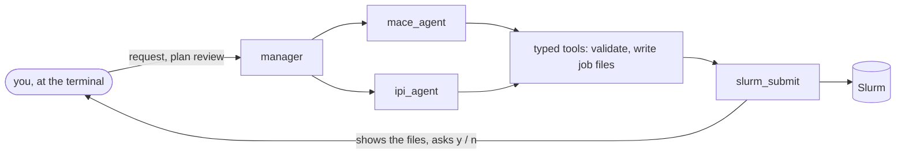

# MACE & i-PI Agent

A terminal assistant for training [MACE](https://github.com/ACEsuit/mace) machine-learning interatomic potentials
and running [i-PI](https://github.com/i-pi/i-pi) molecular dynamics on a Slurm cluster. You describe the job in plain
language; the agent asks for what is missing, writes the job files, shows them to you, and submits only after you
type `y`. It is meant for researchers who know the science but not every MACE option, i-PI tag or `#SBATCH` line.
Built on Hugging Face [smolagents](https://github.com/huggingface/smolagents).

## What it does

- **Trains MACE potentials.** Every option is checked against the MACE version installed in your conda
  environment, and the energy/force/stress keys against your training file, before a `mace_run_train` job is written.
- **Runs i-PI molecular dynamics** with a MACE model, your own or a foundation model (MACE-MP, MACE-OFF), from ten
  templates: NVE, NVT, NPT, path integrals, replica exchange. i-PI itself checks each input. If you have no starting
  structure, the agent builds one.
- **Follows its jobs**: state from `squeue`/`sacct`, and the logs and outputs they write.
- **Leaves the decisions to you**: you approve its plan, answer its questions, and approve every submission after
  seeing the exact files that will run.

## Requirements

- A Slurm login node (tested on Slurm 19.05, CentOS 7) with conda.
- A conda environment for the jobs: `mace-torch` for training; `i-pi`, `ase` and `mace-torch` for molecular dynamics.
- Python 3.11 for the agent itself.
- An API key for an OpenAI-compatible model endpoint. Tested with Anthropic's (`claude-sonnet-5-5`).
- Internet access from the machine running the agent: the model endpoint, web search, GitHub reads, and a one-time
  download of the i-PI manual and its embedding model from Hugging Face (kept in `.cache/`).

## Installation

```bash
git clone https://github.com/Ssbban/smolagents_project.git
cd smolagents_project
python3.11 -m venv .venv            # a fresh environment, only for the agent
# optional: CPU-only torch, about 2.5 GB smaller (the agent needs torch only for searching the i-PI manual)
.venv/bin/pip install torch==2.6.0 --index-url https://download.pytorch.org/whl/cpu
.venv/bin/pip install -r requirements.txt
```

Then tell the agent which model to use and give it your API key, as environment variables in the shell you start
it from:

```bash
export SMOLAGENTS_MODEL_ID=claude-sonnet-5-5
export SMOLAGENTS_API_KEY=your_api_key
export SMOLAGENTS_API_BASE=https://api.anthropic.com/v1    # optional: this is the default
```

To keep them across logins, put these lines in your `~/.bashrc`. The key is read from the environment only; do not
write it into any file of this repository.

Install exactly the versions pinned in `requirements.txt`, in their own environment: the agent is written for
smolagents 1.26.0 (smolagents 1.23 and older stop at start-up with
`TypeError: LocalPythonExecutor.__init__() got an unexpected keyword argument 'timeout_seconds'`). On CentOS 7
(glibc 2.17), the pinned `faiss-cpu` 1.9.0.post1 is the newest release that installs.

## Usage

```bash
.venv/bin/python main.py
```

An abridged session:

```text
User> train a small MACE model on ~/data/ice.xyz for 3 epochs on CPU (energies REF_free_energy, forces REF_forces,
      20% validation), then run a 100-step i-PI NVT simulation at 300 K with it
... the plan ...
Your choice (1-3): 1
Several conda envs have MACE: mace_new_version (0.3.12), mace_venv (0.3.10), smolagent_env (0.3.13). Which one
should the training job use?
=> mace_new_version
============================================================
Job script runs/20261126-200808-a637/01-mace_ice_small/job.sh
============================================================
#!/bin/bash -l
#SBATCH --job-name=mace_ice_small
...
Submit this job? [y = submit, n = do not submit, or type what should change]: y
... the same for the i-PI job ...
Agent> Both jobs completed. The simulation ran all 100 steps and ended at 371 K ...
  file written: runs/20261126-200808-a637/01-mace_ice_small/job.sh (mace_script)
  job submitted: 55961 from runs/20261126-200808-a637/01-mace_ice_small/job.sh
```

- Each request starts with the agent's plan, and a long request is re-planned every
  `SMOLAGENTS_PLANNING_INTERVAL` steps: `1` approves the plan, `2` lets you edit it, `3` cancels the request.
- At the submit question, `y` submits, `n` does not, and anything else is taken as what to change.
- Everything a session writes goes to `runs/<session>/`: one directory per job, and `trace.jsonl`, one line per step,
  tool call and submission.
- Later requests can refer to earlier work ("simulate with the model we just trained"). Ctrl+C ends the current
  request; `exit` ends the session.

## Configuration

All settings are environment variables (`config.py` reads them at start-up).

| Variable | Default | |
|---|---|---|
| `SMOLAGENTS_MODEL_ID` | (required) | a model your provider serves |
| `SMOLAGENTS_API_KEY` | (required) | your API key for that provider |
| `SMOLAGENTS_API_BASE` | `https://api.anthropic.com/v1` | any OpenAI-compatible endpoint |
| `SMOLAGENTS_TEMPERATURE` | provider default | |
| `SMOLAGENTS_MAX_STEPS` | 20 | steps per agent and request |
| `SMOLAGENTS_PLANNING_INTERVAL` | 10 | the manager re-plans, and asks you again, every N steps |
| `SMOLAGENTS_RUNS_DIR` | `runs` | |

If a required variable is missing, the agent stops at start-up and names it. Requests, tool results and cluster
facts are sent to the model endpoint.

## How it works



A manager agent passes each request to a MACE agent or an i-PI agent. The agents act by writing Python code, but
that code can neither open files nor run commands: only the project's tools write files, after checking their
inputs, into `runs/<session>/`. `slurm_submit` submits only a job script those tools wrote in this session,
unchanged, and only after it has shown it to you and you answered `y`. So the model decides what to do, the tools
decide how it is done, and you decide whether a job runs. [docs/DESIGN.md](docs/DESIGN.md) explains each mechanism.

## Project structure

```text
main.py                  terminal session: one request is one run of the manager
agents.py                the manager and the two specialist agents
config.py                settings (environment variables)
requirements.txt         pinned dependencies
prompts/                 guidance for each agent
tools/
  session.py, trace.py   what a session wrote and submitted; the JSON trace
  plan_review.py         the plan review at the start of a request
  slurm_config.py        cluster probe: partitions, nodes, conda environments
  specs.py               validation of Slurm and job settings
  mace_cli_schema.py     MACE options of the installed version
  mace_script.py         MACE training job
  structure_writer.py    starting structures
  ipi_*.py               i-PI input (checked by i-PI), ASE client, job script, tag help
  ipi_templates/         ten i-PI input templates, pinned to their source
  preflight.py           checks before submission
  approval.py            the y / n question
  slurm_submit.py        submission
  job_status.py          job state and log tail
  job_output.py          reading a job's outputs
  retriever.py           search in the i-PI manual
  github_fetch.py        read a file from GitHub (MACE's README)
  show_content.py        show a generated file
docs/                    design, the first run on a real cluster, the defects of v1
```

## Status and limits

- Run on one cluster with one model: four requests and five jobs, all completed, each submitted after the person's
  `y` ([docs/CLUSTER_RUN.md](docs/CLUSTER_RUN.md)). Success rates over many requests have not been measured.
- smolagents' Python sandbox is not a security boundary against a hostile model; the guarantees above hold for
  mistakes, not attacks ([docs/DESIGN.md](docs/DESIGN.md), "Known limits").
- This is the second version; [docs/V1_DEFECTS.md](docs/V1_DEFECTS.md) lists what was wrong with the first and what
  fixed it.
- No licence file yet.

## Credits

- [smolagents](https://github.com/huggingface/smolagents) (Hugging Face): agents, code execution, managed agents.
- [MLIPs-with-iPI](https://github.com/venkatkapil24/MLIPs-with-iPI): the ten i-PI input templates, vendored with
  checksums; licence and source in `tools/ipi_templates/`.
- [MACE](https://github.com/ACEsuit/mace): the option table is read from the `arg_parser.py` of the MACE you have
  installed.
- [i-PI](https://github.com/i-pi/i-pi): its loader checks generated inputs; its input classes answer `ipi_tag_help`.
- [gte-small](https://huggingface.co/thenlper/gte-small) embeds the i-PI manual for the search tool.
